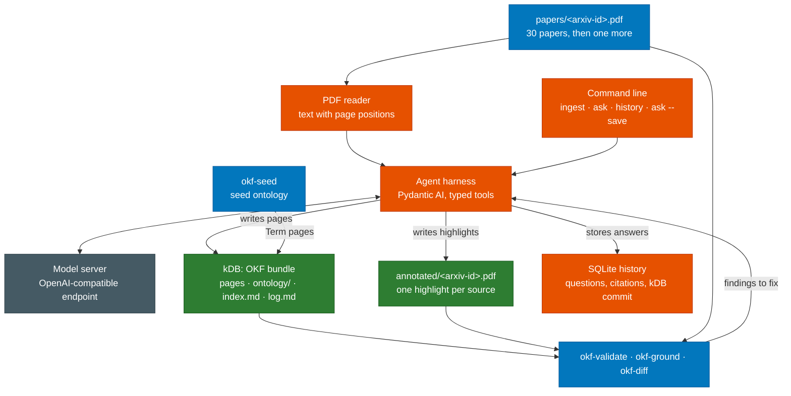

# Physical AI Knowledge DB (kDB)

Student project for Introduction to AI. The project page on aegean.ai describes the task:
compile a library of 30 papers on vision-language-action models into a grounded Knowledge DB
(kDB) in the
[Open Knowledge Format (OKF) v0.2](https://github.com/GoogleCloudPlatform/knowledge-catalog/blob/main/okf/SPEC.md),
then ingest one held-out paper and keep the kDB correct. A kDB is a continuously updated
information source in which every claim points to the sentence or table cell that supports it,
and a tool, not a reader's trust, confirms that the evidence is there.

## Grounded answers for mission-critical work

A language model writes fluent, confident text whether or not any source supports it. When the
question is about a film, a wrong answer costs nothing. In industries where a document decides
what someone does next, it can cost an aircraft, a patient or a plant. A technician follows the
torque value in a maintenance manual. A pharmacist follows the dose in a drug label. An operator
follows the step in a reactor procedure. An engineer sizes a motor from a datasheet. In each case
the answer is only useful if it can be traced to the document that states it, and the trace can
be checked before anyone acts on it.

Courts have already ruled on what happens when that check is skipped. In 2023 a federal court in
New York sanctioned two lawyers who filed a brief citing court decisions that ChatGPT had
invented (Mata v. Avianca). In 2024 a Canadian tribunal held Air Canada liable for a refund
policy that its website chatbot made up (Moffatt v. Air Canada). Neither failure came from a
model that sounded uncertain. Both answers looked authoritative, and nobody compared them with a
source.

Retrieval-augmented generation (RAG) narrows the problem but does not close it. Retrieval puts
relevant passages in front of the model, and the model can still join fragments wrongly, file a
number under the wrong experiment, or cite a document that does not say what the answer says. A
citation that a reader has to trust is a pointer, not a proof. Building the reference kDB for
this project showed how quietly this happens. Two result tables were printed side by side on one
page of a paper, the extractor read each printed line as one row, and numbers measured on one
benchmark were filed under another. Every number really was on the cited page, so a check that
asks only "is this text in the document" passed. It was caught when a number looked wrong and
someone compared it with the table it came from, and the reader was then fixed to split tables
that share a line.

A kDB is built to make that kind of error visible and checkable. Each claim is compiled once into
a page and carries its evidence: the paper, the page, the exact sentence or table cell, and the
box on the page where it appears. `okf-ground` confirms that every one of those is where the page
says, and the highlight in the annotated PDF lets a person verify a claim in seconds. Results
state their conditions as ontology terms, so numbers measured under different setups are never
compared as if they were one. When two sources disagree, the kDB keeps both and records the
dispute instead of picking a winner. Git history and `okf-diff` show exactly what each new
document changed, and the question history records which version of the kDB every answer relied
on. When the kDB does not contain an answer, the right response is to say so, and the project is
graded on refusing as well as on answering.

These are the properties that auditors and regulators ask for: traceability from every statement
to its source, a record of what changed and when, and a clear line between what the sources say
and what they do not. The EU AI Act already requires high-risk AI systems to keep records that
make their operation traceable. Many of the documents involved cannot leave the organization that
holds them, because of patient privacy, export control or trade secrets, so this project runs on
local open-weight models only.

The library here is research on robot learning, but nothing in the method depends on it. Replace
the 30 papers with an aircraft's maintenance manuals, a drug's regulatory filings or a plant's
operating procedures, and the same checks apply. That is what you practice in this project:
building an agent whose every output a tool can verify, measuring it against a RAG baseline on
correctness and on tokens, and teaching it when the honest answer is that the sources do not say.

The checks have a limit, and it matters. They prove that a quoted sentence or value is where its
source says it is; they cannot prove that the sentence supports the claim attached to it. That
judgment stays with a person, which is why a TA reads a sample of claims at grading time.

This repository holds the tools that check your kDB. The checks come from
[aegean-ai/kdb-tools](https://github.com/aegean-ai/kdb-tools), which other course projects that
build a kDB share; this repository adds the rules and the seed ontology of this project, and
installing it gives you both. The course runs the same tools at grading time, so a clean run
here means the mechanical checks will pass.

## Your tasks, in order

The project page on aegean.ai is the full statement of the task, the rules and the grading. These
are the steps it asks for, in the order that works.

1. Set up. Install the tools (see [Install](#install)), and run an OpenAI-compatible model server
   with an open-weight model of your choice, such as Ollama, llama.cpp, vLLM, SGLang or LM Studio.
   Your agent reads the server's `base_url` and the model name from a config file, because we run
   it against our own server at grading time. Local models only: no document text goes to a
   hosted model API.
2. Get the library. Download the 30 papers listed on the project page, each at the arXiv version
   it links, and save each as `kdb/papers/<arxiv-id>.pdf`. Keep the paper marked "ingest last"
   aside. Make `kdb/` a git repository.
3. Seed the ontology. Run `okf-seed kdb` once. It writes the robotics, datasets and vla-datasets
   ontologies as `Term` pages, each defined by a quote it highlights in your copy of a paper, and
   `okf-validate kdb` and `okf-ground kdb` pass on the result.
4. Build your agent. Write the harness in Python with Pydantic AI: typed tools that read a PDF
   with page positions, find quotes and table cells with `kdb_tools.locate.find_quote`, write
   highlights with `kdb_tools.annotate.highlight`, and write kDB pages. Make the tools reject a
   bad call, such as a quote that is not on the cited page, so the model gets the error and tries
   again. Check the size of every prompt before you send it: a server cuts a prompt longer than
   its context without an error.
5. Write `ingest <pdf>`. It adds one paper to an existing kDB and changes only the pages that
   paper affects. Each model, dataset, benchmark and robot gets one page, every result states its
   conditions as ontology terms, every model names its training datasets in `trained_on`, and a
   claim a newer paper disputes stays, with `contested_by` pointing at the new sources. It updates
   `index.md` and appends one entry to `log.md`.
6. Build the kDB from the 30 papers, one `ingest` at a time, committing after each. After every
   paper run `okf-validate kdb` and `okf-ground kdb` and have your agent fix what they report.
   Test the incremental update yourself: hold one paper out, ingest it last, and run
   `okf-diff kdb --git <before> HEAD`.
7. Write the question commands. `ask "<question>"` answers from the kDB alone, cites a source
   for every sentence and says so when the kDB does not contain the answer; `--show` displays each
   cited region with its highlight. `history` lists earlier questions, and `ask --save` files an
   answer back into the kDB as an `Analysis` page that passes both checks. Keep the history in a
   SQLite file next to the kDB.
8. Submission 1: your code and command-line program, the kDB built from the 30 papers with its
   ontology, and the annotated PDFs. The paper marked "ingest last" must not be in it.
9. Ingest the held-out paper with one `ingest`. Run `okf-diff` between Submission 1 and the new
   commit, and write a findings report of at most two pages: every page that changed and why,
   every claim the new paper contradicts or supersedes with both sources, and anything you marked
   as contested.
10. Submission 2: the updated kDB, the new annotated PDF and the findings report.
11. The demo. A TA asks your program questions with `ask`, including one that needs several papers
    and one the library cannot answer, looks at the highlights with `--show`, saves an answer with
    `--save` and reads your `history`.

Stretch goals, for credit beyond the required score, are on the project page: standing queries
refreshed on every ingest, extensions to the ontology, and a short write-up of how your agent
reads a paper longer than its context window.

## Where the tools fit

Orange boxes are what you build. Blue boxes come from the course: the papers you download,
the seed ontology and the checks in this repository. The model server runs an open-weight model
of your choice behind an OpenAI-compatible endpoint.



Green boxes are what you submit, along with your code. The checks only read the kDB, the
annotated PDFs and the papers; they never call a model.

| Tool | What it checks |
|---|---|
| `okf-validate` | the bundle is valid OKF v0.2 and follows the project rules: sources, citations, index, log and one page per entity |
| `okf-ground` | every quoted sentence is on its cited page and inside its bbox, every table value is inside its bbox, and every bbox matches a highlight in your annotated PDF |
| `okf-diff` | which pages changed between two versions of the kDB, and whether pages the new paper did not touch stayed byte-identical |
| `okf-seed` | writes the course's seed ontology into the kDB: one `Ontology` page per ontology (robotics, datasets, and vla-datasets, which extends datasets) and one `Term` page per term, each defined by a quote it finds and highlights in your copy of a library paper |

`okf-validate`, `okf-ground` and `okf-diff` only read your bundle. `okf-seed` writes the ontology pages, their highlights and one log entry. None of the tools calls a model.

## Design choices

### Pluggable rules

The checks are split into a core that every kDB follows and a profile per project. The core is
[aegean-ai/kdb-tools](https://github.com/aegean-ai/kdb-tools): OKF conformance, sources and
citations, grounding against the PDFs, diffs, and the ontology machinery. This repository is the
`vla` profile: the rules for the page types this project needs, and its seed ontology. The AR4
digital twin project, which builds a kDB of a robot arm's manuals and datasheets, uses the same
core with a profile of its own.

| Rules | Where they live | What they cover |
|---|---|---|
| `okf.*` | core | frontmatter, `type`, index and log files, as OKF v0.2 defines them |
| `project.index`, `project.log`, `project.generated`, `project.source`, `project.citation`, `project.footnote`, `project.unused-source`, `project.uncited`, `project.aliases`, `project.entity`, `project.contested`, `project.computation` | core | evidence and bookkeeping that any kDB needs |
| `project.ontology`, `project.term`, `project.term-label` | core | layered ontologies and their terms |
| `ground.*`, `diff.*` | core | evidence in the PDFs, and what an update changed |
| `project.result`, `project.condition`, `project.dataset`, `project.trained-on` | `vla` profile | results with their conditions, datasets, training data and model classes |

A profile is a small Python object registered as an entry point in the group
`kdb_tools.profiles`. It names a function that checks one page and a directory of seed specs.
`okf-validate` runs the core rules on every page and then the rules of each installed profile;
`okf-seed` writes the seeds of the installed profiles. Both take `--profile` to use one profile
only. Installing this repository installs the core and the `vla` profile together, so the
commands you run are the ones we grade with.

The split exists so that a fix lands once. A grading tool that two projects copy drifts: a bug
fixed in one copy stays in the other, and students in two courses are graded by different code.
It also means a project adds rules without forking the checker. You can do the same for your own
work: register a profile with extra checks that your agent runs during ingest, such as a rule
that every result page names its trial count. Grading uses only the course's profile.

### Files in git are the source of truth

The kDB is a directory of markdown files in a git repository, not a database. Files can be read
by any tool, diffed, reviewed and reverted, and the grading of the incremental update depends on
that: `okf-diff` compares two commits and checks that pages a new paper did not touch stayed
byte-identical. A database or a search index is still useful for answering questions quickly,
but it is built from the files and can be thrown away and rebuilt. The files are never written
from it.

### Evidence is pinned in PDF coordinates

A source names the paper, the page, the exact quote or table value, and a `bbox` in PDF points
with the origin at the bottom-left corner of the page. That is the coordinate space PDF
highlights use, so a bbox can be compared with your highlight directly. Text extractors measure
from the top of the page; `okf-ground` notices a bbox measured that way and prints the corrected
one. A table value is checked by its position, not only by its presence, because the same number
often appears in several tables on a page.

### Quotes are matched in drawing order

A PDF does not store sentences. It stores characters and where to draw them, and text extractors
reorder lines, so two columns at the same height come out interleaved. `okf-ground` matches a
quote against the characters in the order the PDF draws them, then in reading order, then column
by column, and it rejects a match that jumps across the gap between columns: words spliced from
two columns are not a sentence of the paper. `kdb_tools.locate.find_quote` uses the same
matcher, so your agent and the checker agree on where a quote is.

### Terms, not words

The same word names different things across papers. LIBERO-90 is an evaluation suite of the
LIBERO benchmark and also a set of tasks used as pretraining data. Conditions, dataset properties
and model classes therefore name `Term` pages of an ontology, with preferred and alternative
labels and `broader` links in the style of W3C SKOS. Ontologies are layered: `vla-datasets`
extends `datasets`, so a question about pretraining also finds cross-embodiment pretraining.
Every term is defined by a sentence quoted from a library paper, grounded like any other claim.

### The checks never call a model

Every check is deterministic: the same bundle gives the same findings on your machine and at
grading time, at no cost, in seconds. Each tool prints a report for people and, with `--json`,
one for your agent, and exits with 0 when there are no errors, 1 when there are errors and 2
when it could not run. The one judgment the tools leave out, whether a cited sentence supports
its claim, is left to a person on purpose.

### Your agent and our checks are separate

You write the agent that reads papers and writes pages, with any open-weight model behind an
OpenAI-compatible server. We own the checks. The boundary is the bundle format, so you are free
to build the agent however you like. The checks grade the kDB it produces, whatever produced it,
and the demo grades the answers your program gives from that kDB.

## Install

The tools need Python 3.11 or newer and [uv](https://docs.astral.sh/uv/).

```bash
uv tool install git+https://github.com/pantelis/physical-ai-kdb
```

## Run

```bash
okf-seed kdb          # once, before the first ingest; needs papers/<arxiv-id>.pdf
okf-validate kdb
okf-ground kdb
okf-diff kdb --git submission-1 HEAD
okf-diff old-kdb/ kdb/
```

Add `--json` to any command for a report your agent can read. The exit status is 0 when there
are no errors, 1 when there are errors and 2 when the tool could not run.

## Use them from Python

The same checks are a Python package, so your agent can call them as functions and read the
findings directly. Add it to your project with `uv add git+https://github.com/pantelis/physical-ai-kdb`.

```python
from pathlib import Path

import pdfplumber

from kdb_tools.ground import ground
from kdb_tools.locate import find_quote
from kdb_tools.validate import validate

kdb = Path("kdb")
for finding in validate(kdb).findings + ground(kdb).findings:
    print(finding.level, finding.rule, finding.path, finding.message)

with pdfplumber.open(kdb / "papers" / "fei2025.pdf") as pdf:
    spans = find_quote(pdf.pages[0], "yet these results may mask fundamental weaknesses in robustness")
print(spans)  # one [x0, y0, x1, y1] per occurrence, in PDF points from the bottom left
```

`find_quote` matches the same way `okf-ground` does, so a bbox it returns passes the check.

To write the highlights into the annotated copy, use `kdb_tools.annotate.highlight`. It finds
each quote on its page and draws one highlight box per line, so only the quoted words are
shaded. Give the bbox from your source entry when the text appears more than once on the page:

```python
from kdb_tools.annotate import highlight

found = highlight(
    "kdb/papers/fei2025.pdf",
    "kdb/annotated/fei2025.pdf",
    [(3, "97.1", "fei2025-t1-r2-c1", [190.64, 596.07, 207.72, 605.83])],  # page, text, comment, bbox
)
print(found)  # [True]: one flag per mark; False means the text is not on that page
```

## The rules in detail

The [kdb-tools design](https://github.com/aegean-ai/kdb-tools/blob/main/docs/design.md) lists
the rules every kDB follows, the bundle layout, how paths and bbox coordinates are interpreted,
and what the tools do not check. [`docs/design.md`](docs/design.md) lists the rules this
project adds and describes its seed ontology.

## Develop

```bash
uv sync
uv run pytest
```
