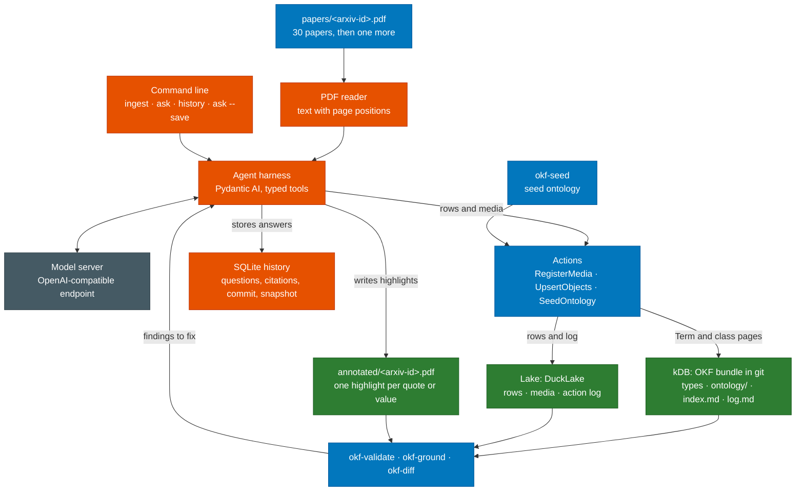

# Physical AI Knowledge DB (kDB)

Student project for Introduction to AI. The project page on aegean.ai describes the task:
compile a library of 30 papers on vision-language-action models into a grounded Knowledge DB
(kDB) in the
[Open Knowledge Format (OKF) v0.2](https://github.com/GoogleCloudPlatform/knowledge-catalog/blob/main/okf/SPEC.md),
then ingest one held-out paper and keep the kDB correct. A kDB is a continuously updated
information source in which every claim points to the sentence or table cell that supports it.
A tool confirms that the evidence is there. The kDB holds the types, as pages in git. Each paper,
model, dataset and result is a row in a lake on your own machine, and every change to either is a
logged action.

## Grounded answers for mission-critical work

A language model writes fluent, confident text whether or not a source supports it. In a chat
about films a wrong answer costs nothing. Where a document decides what someone does next, the
cost is real: a technician sets the torque value printed in a maintenance manual, and a
pharmacist gives the dose on a drug label. Reactor procedures and motor datasheets are used the
same way. An answer drawn from documents like these is useful only if it can be traced to the
passage that states it, and someone has to check that trace before acting on it.

Two court cases show what happens when nobody checks. In 2023 a federal court in New York
sanctioned two lawyers who filed a brief citing court decisions that ChatGPT had invented
(Mata v. Avianca). In 2024 a Canadian tribunal held Air Canada liable for a refund policy its
website chatbot made up (Moffatt v. Air Canada). Both answers looked authoritative, and nobody
compared them with a source.

Retrieval-augmented generation (RAG) helps by putting relevant passages in front of the model,
but the model can still combine fragments wrongly or cite a passage that does not support its
answer. A citation only tells the reader where to look. We ran into this while building the
reference kDB for this project. One paper prints two result tables side by side, and our
extractor read each printed line as one row, so numbers from one benchmark were filed under
another. Every number was on the cited page, so a check that only asks whether the text is in
the document passed. We found the error when a number looked wrong and someone compared it with
its table, and we then changed the reader to split tables that share a line.

In a kDB, each claim is written once into a row together with its evidence: the paper, the
page, the exact sentence or table cell, and the box on the page where it appears. `okf-ground`
checks that the evidence is where the row says it is, and the highlight in the annotated PDF
lets a person confirm a claim in seconds. Results record their conditions as ontology terms, so
numbers measured under different setups are not compared with each other. When two sources
disagree, the kDB keeps both and records the dispute. The action log and `okf-diff` show what
each new paper changed, and the question history records which version of the kDB each answer
used.
If the kDB does not contain an answer, your program should say so; refusals are graded along
with answers.

Audits in regulated industries ask for the same things: a trace from each statement to its
source, a record of what changed and when, and a plain answer when the sources say nothing. The
EU AI Act requires high-risk AI systems to keep records that make their operation traceable.
Many of these documents cannot leave the organization that holds them, for reasons such as
patient privacy, export control or trade secrets, so an agent for them has to run on local
models. The papers in this project are public, so you may also use OpenRouter (see the next
section).

The papers in this library are about robot learning, but nothing in the method depends on that.
With an aircraft's maintenance manuals or a plant's operating procedures in place of the papers,
the same checks apply. In this project you build an agent whose output a tool can verify,
compare it with a RAG baseline on correctness and token use, and teach it to say when the
sources have no answer.

The checks prove that a quoted sentence or value is where its source says it is. They cannot
prove that the sentence supports the claim it is attached to, so a TA reads a sample of claims
at grading time.

This repository holds the tools that check your kDB. The checks come from
[aegean-ai/kdb-tools](https://github.com/aegean-ai/kdb-tools), which other course projects that
build a kDB share. This repository adds the rules and the seed ontology for this project.
Installing it gives you both. The course runs the same tools at grading time, so a clean run
here means the mechanical checks will pass.

## Models and agents you may use

You build the agent yourself, in Python, with Pydantic AI. That agent is what this project is
about, so no other agent may do its work. Commercial agent products and hosted agent services,
such as the ChatGPT, Claude or Gemini apps, NotebookLM or a hosted agent platform, are not
accepted, and neither is a framework that runs its own agent to write the kDB.

The model behind your agent can come from one of three places:

1. A local OpenAI-compatible server with an open-weight model, such as Ollama, llama.cpp, vLLM,
   SGLang or LM Studio.
2. A free model on [OpenRouter](https://openrouter.ai/models), whose model ids end in `:free`.
   Free models are rate limited, so ingest runs slower.
3. A paid model on OpenRouter, with a strict credit limit set on your API key before you start.
   One build of the kDB from the 31 papers took our reference agent about 3.6 million input tokens
   and 0.8 million output tokens, and you will build it many times while you develop.

No other hosted model API is allowed. Keep your OpenRouter key in an environment variable and
never in a file you commit; the starter reads it from the variable named in `kdb.toml`. The papers
in the library are public, which is why OpenRouter is allowed here. With private documents, the
same agent would run on a local model.

## Your tasks, in order

The project page on aegean.ai is the full statement of the task, the rules and the grading. These
are the steps it asks for, arranged in the order that works.

1. Set up. Copy [`starter/`](starter/README.md) into your own repository, run `uv sync`, and
   choose your model as described in
   [Models and agents you may use](#models-and-agents-you-may-use): a local server, a free
   OpenRouter model, or a paid OpenRouter model with a credit limit on your key. Your agent reads
   the `base_url`, the model name and the name of the key's environment variable from `kdb.toml`,
   because we run it against our own server at grading time.
2. Get the library. Download the 30 papers listed on the project page, each at the arXiv version
   it links, and save each as `kdb/papers/<arxiv-id>.pdf`. Download the paper marked "ingest
   last" too, because the seed ontology quotes it, but do not ingest it yet. Make `kdb/` a git
   repository.
3. Make your lake. Run `uv run kdb lake init --team <team>` with your team id, or your own id if you work alone. It adds
   a local lake to `kdb.toml`, writes the core and VLA classes into the kDB, and binds each class
   to a table. The lake can keep its data in RustFS on your own machine instead; the starter's
   `kdb.toml.example` explains how.
4. Seed the ontology. Run `uv run okf-seed kdb` once. It writes the robotics, datasets and
   vla-datasets ontologies as `Term` pages. Each term is defined by a quote that the tool
   highlights in your copy of a paper, so it needs these ten papers in `kdb/papers/`:
   2112.03227, 2306.03310, 2307.15818, 2308.12952, 2310.08864, 2405.05941, 2405.12213,
   2410.24164, 2502.19645 and 2510.13626. `okf-validate kdb` and `okf-ground kdb` pass on the
   result.
5. Build your agent with Pydantic AI, starting from the starter's plumbing. Use typed tools that
   read a PDF with page positions, find quotes and table cells with `kdb_tools.locate.find_quote`,
   write highlights with `kdb_tools.annotate.highlight`, and write rows with the `UpsertObjects`
   action. Make the tools reject a bad call, such as a quote that is not on the cited page. The
   model then gets the error and tries again. Check the size of every prompt before you send it.
   A server cuts a prompt longer than its context without an error.
6. Write `ingest <pdf>`. It registers the PDF with `RegisterMedia` and adds what the paper says to
   the lake as rows, changing only the rows that paper affects. Each paper, model and dataset gets
   one row. Every result states its conditions as Term IRIs, and every dataset a model was trained
   on is a `trained_on` row. A claim that a newer paper disputes stays, and a `contested` row
   points at the new evidence. Highlight every quote and value, then register the annotated copy
   with `RegisterMedia` and the sha256 of the paper in `annotates`.
7. Build the kDB from the 30 papers, one `ingest` at a time, committing the kDB after each. After
   every paper, run `okf-validate kdb` and `okf-ground kdb`, and have your agent fix what they
   report. Test the incremental update yourself: hold one paper out, ingest it last, and run
   `okf-diff kdb --lake-config kdb.toml --snapshots <before> <after>` on the lake's snapshots
   from before and after.
8. Write the question commands. `ask "<question>"` answers from the lake alone, cites rows and
   their evidence for every sentence and says so when the lake does not contain the answer.
   `--show` displays each cited region with its highlight. `history` lists earlier questions, and
   `ask --save` files an answer back as an `analyses` row that passes both checks. Keep the
   history in a SQLite file next to the kDB.
9. Submission 1: your code and command-line program, the kDB repository at a commit with its
   ontology, the papers and the annotated PDFs, and `kdb export` of the lake into your shared
   Google Drive folder. No row may cite the paper marked "ingest last".
10. Ingest the held-out paper with one `ingest`. Run `okf-diff --snapshots` between Submission 1
    and now, and write a findings report of at most two pages: every row and page that changed
    and why, every claim the new paper contradicts or supersedes with both sources, and every
    `contested` row you wrote.
11. Submission 2: the updated kDB repository, the new annotated PDF, a new export of the lake and
    the findings report.
12. The demo. A TA asks your program questions with `ask`, including one that needs several papers
    and one the library cannot answer. The TA looks at the highlights with `--show`, saves an
    answer with `--save` and reads your `history`.

Stretch goals, for credit beyond the required score, are on the project page: standing queries
refreshed on every ingest, extensions to the ontology, and a short write-up of how your agent
reads a paper longer than its context window.

## Where the tools fit

Orange boxes are what you build. Blue boxes come from the course: the papers you download,
the seed ontology, the actions and the checks. The model server is a local server or
OpenRouter, behind an OpenAI-compatible endpoint.



Green boxes are what you submit, along with your code: the kDB repository at a commit, and an
export of the lake. The checks read only the kDB, the lake and the files registered in it. They
never call a model.

| Tool | What it checks |
|---|---|
| `okf-validate` | the bundle is valid OKF v0.2 and follows the project rules; with the lake, the rows follow the rules of the VLA classes, and every page was written by a logged action |
| `okf-ground` | every quoted sentence is on its cited page and inside its bbox, every table value is inside its bbox, and every bbox matches a highlight in the annotated PDF, for the Term pages and for the evidence of every row; every cited file is registered and its bytes match its sha256 |
| `okf-diff` | which pages changed between two versions of the kDB; with `--snapshots`, which rows changed between two snapshots of the lake and which action changed each one |
| `okf-seed` | writes the course's seed ontology into the kDB through the `SeedOntology` action: one `Ontology` page per ontology (robotics, datasets, and vla-datasets, which extends datasets) and one `Term` page per term, each defined by a quote it finds and highlights in your copy of a library paper; it needs a lake |
| `okf-export`, `okf-restore` | write the lake into a folder with a manifest of hashes, and restore it after checking every hash |

`okf-validate`, `okf-ground` and `okf-diff` only read. `okf-seed` writes the ontology pages, their highlights and one action. None of the tools calls a model.

## Design choices

### Pluggable rules

The checks are split into a core that every kDB follows and a profile for each project. The core is
[aegean-ai/kdb-tools](https://github.com/aegean-ai/kdb-tools). It handles OKF conformance, sources
and citations, grounding against the PDFs, diffs, and the ontology machinery. This repository is
the `vla` profile. It contains the rules for the page types this project needs and its seed
ontology. The AR4 digital twin project, which builds a kDB of a robot arm's manuals and
datasheets, uses the same core with its own profile.

| Rules | Where they live | What they cover |
|---|---|---|
| `okf.*` | core | frontmatter, `type`, index and log files, as OKF v0.2 defines them |
| `project.index`, `project.log`, `project.generated`, `project.source`, `project.citation`, `project.footnote`, `project.unused-source`, `project.uncited`, `project.aliases`, `project.entity`, `project.contested`, `project.computation` | core | evidence and bookkeeping that any kDB needs |
| `project.ontology`, `project.term`, `project.term-label` | core | layered ontologies and their terms |
| `ground.*`, `diff.*` | core | evidence in the PDFs, and what an update changed |
| `project.result`, `project.condition`, `project.dataset`, `project.trained-on`, `project.entity`, `project.iri` | `vla` profile | rows of results with their conditions, datasets, training links and models, and the IRIs of rows and types |

A profile is a small Python object registered as an entry point in the group
`kdb_tools.profiles`. It names a function that checks pages, a function that checks lake rows,
or both, and a directory of seed specs. `okf-validate` runs the core rules on every page, then the
rules of each installed profile. Row rules run only when `kdb.toml` configures a lake.
`okf-seed` writes the seeds of the installed profiles. Both take `--profile` to use one profile
only. Installing this repository installs the core and the `vla` profile together, so the
commands you run are the ones we grade with.

With one core, a fix reaches every project that uses it. If two projects each kept a copy of
the grading tool, a bug fixed in one copy would stay in the other, and students in the two
courses would be graded by different code. The split also lets a project add rules without forking the checker. You can
use the same approach for your own work. Register a profile with extra checks that your agent
runs during ingest, such as a rule that every result page names its trial count. Grading uses
only the course's profile.

### Types in git, instances in the lake

The kDB holds types only: the ontology terms, and the classes and properties that say what a
paper, a model or a result is. They are markdown files in a git repository, so any tool can read
them, and git can diff, review and revert them. Every instance is a row in the lake: each paper,
model, dataset, training link, result, contested claim, computation and analysis. Anything that
makes sense only for one paper or one model belongs in the lake. This keeps the kDB the same size
however many papers a team ingests, and it lets a question run as a query over tables.

The two cannot drift apart because every change to either goes through a typed action, and each
action writes a row to the action log in the lake. `okf-validate` reports a page whose bytes match
no logged action, and `okf-diff --snapshots` reports a row change that no logged action made.
Grading the incremental update depends on this: the diff between two snapshots lists every row the
new paper changed and the action that changed it.

### Evidence is pinned in PDF coordinates

A row's evidence is a list of `MediaRef`s. Each names the paper by the sha256 of its PDF, with the
page, the exact quote or table value, and a `bbox` in PDF points with the origin at the
bottom-left corner of the page. PDF highlights use that coordinate space,
so a bbox can be compared with your highlight directly. Text extractors measure from the top of
the page. `okf-ground` notices a bbox measured that way and prints the corrected one. A table
value is checked by its position as well as its presence because the same number often appears
in several tables on a page.

### Quotes are matched in drawing order

A PDF stores characters and their drawing positions rather than sentences. Text extractors
reorder lines, so two columns at the same height can come out interleaved. `okf-ground` first
matches a quote against the characters in the order the PDF draws them. It then tries reading
order and finally checks column by column. It rejects a match that jumps across the gap between
columns because words spliced from two columns do not form a sentence in the paper.
`kdb_tools.locate.find_quote` uses the same matcher, so your agent and the checker agree on where
a quote is.

### Conditions name ontology terms

The same word names different things across papers. LIBERO-90 is an evaluation suite of the
LIBERO benchmark and also a set of tasks used as pretraining data. Conditions, dataset properties
and model classes therefore name `Term` pages of an ontology. Those pages have preferred and
alternative labels, with `broader` links in the style of W3C SKOS. Ontologies are layered:
`vla-datasets` extends `datasets`, so a question about pretraining also finds cross-embodiment
pretraining. Every term is defined by a sentence quoted from a library paper and grounded like
any other claim.

### The checks never call a model

Every check is deterministic, so the same bundle gives the same findings on your machine and at
grading time. It runs at no cost and finishes in seconds. Each tool prints a report for people.
With `--json`, it also prints one for your agent. It exits with 0 when there are no errors, 1 when
there are errors and 2 when it could not run. The tools leave one judgment to a person: whether a
cited sentence supports its claim.

### Your agent and our checks are separate

You write the agent that reads papers and writes rows, with Pydantic AI, using a local model or
one on OpenRouter. We own the checks and the actions. The VLA classes and the actions define the
boundary, leaving you free to build the agent however you like. The checks grade the kDB it produces regardless of how
it was produced. The demo grades the answers your program gives from that kDB.

## Install

The tools need Python 3.11 or newer and [uv](https://docs.astral.sh/uv/). Your copy of the
starter installs everything: `uv sync` there installs the `kdb` command, the checks and the
actions, and `uv run` runs them. To install the four checks as commands of their own, outside a
project, use:

```bash
uv tool install git+https://github.com/pantelis/physical-ai-kdb
```

That gives `okf-validate`, `okf-ground`, `okf-diff` and `okf-seed`. `okf-export` and
`okf-restore` come with the starter.

## Run

Run these from your project folder, the one that holds `kdb.toml`:

```bash
uv run kdb lake init --team team-7   # once: the lake, the VLA classes and their tables
uv run okf-seed kdb                  # once, before the first ingest; needs the ten seed papers
uv run okf-validate kdb
uv run okf-ground kdb
uv run okf-diff kdb --lake-config kdb.toml --snapshots 18 34
uv run okf-diff kdb --git HEAD~1 HEAD
uv run kdb export ../drive
```

`okf-validate` and `okf-ground` use the `kdb.toml` in the bundle's folder or the nearest folder
above it, and check the rows of the lake it names. Add `--json` to any check for a report your
agent can read. The exit status is 0 when there are no errors, 1 when there are errors and 2 when
the tool could not run.

## Use them from Python

The same checks are available as a Python package, so your agent can call them as functions and
read the findings directly. The starter already depends on it. Called from Python, `validate()`
and `ground()` check rows only when you pass them the lake:

```python
from pathlib import Path

import pdfplumber

from kdb_tools.ground import ground
from kdb_tools.lake import Lake, load_config, store_for
from kdb_tools.locate import find_quote
from kdb_tools.validate import validate

kdb, cfg = Path("kdb"), load_config(Path("kdb.toml"))
lake = Lake.open(cfg)
try:
    report = validate(kdb, lake=lake).findings + ground(kdb, lake=lake, store=store_for(cfg)).findings
finally:
    lake.close()
for finding in report:
    print(finding.level, finding.rule, finding.path, finding.message)

with pdfplumber.open(kdb / "papers" / "2310.08864.pdf") as pdf:
    spans = find_quote(pdf.pages[2], "The Open X-Embodiment Dataset contains 1M+ real robot trajectories spanning 22 robot embodiments")
print(spans)  # one [x0, y0, x1, y1] per occurrence, in PDF points from the bottom left
```

`find_quote` matches text the same way `okf-ground` does, so a bbox it returns passes the check.

To write the highlights into the annotated copy, use `kdb_tools.annotate.highlight`. It finds
each quote on its page and draws one highlight box per line. This shades only the quoted words.
It keeps the highlights already in the file. Give the bbox from your `MediaRef` when the text
appears more than once on the page:

```python
from kdb_tools.annotate import highlight

found = highlight(
    "kdb/papers/2502.19645.pdf",
    "kdb/annotated/2502.19645.pdf",
    [(6, "94.5", "oft-table-1-libero-long", [448.52, 365.44, 462.01, 373.15])],  # page, text, comment, bbox
)
print(found)  # [True]: one flag per mark; False means the text is not on that page
```

Register the annotated copy with `RegisterMedia` once all of the paper's highlights are in it.

## The rules in detail

The [kdb-tools design](https://github.com/aegean-ai/kdb-tools/blob/main/docs/design.md) lists
the rules every kDB follows, the bundle layout, how paths and bbox coordinates are interpreted,
and what the tools do not check. [`docs/design.md`](docs/design.md) lists the rules this
project adds and describes its seed ontology.

## Develop

```bash
uv sync
uv run pytest
```
